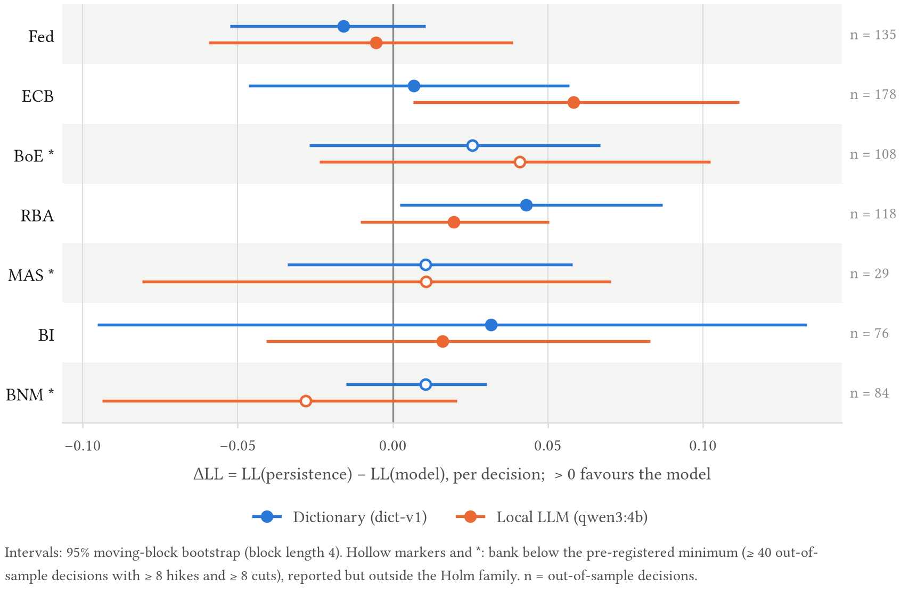

# cbtone

**Hawkish/dovish tone signals from public central-bank communication, with the evaluation machinery to test
whether those signals carry information about later policy decisions and market reactions.**

[](https://github.com/thanatchon36/cbtone/actions/workflows/ci.yml)
[](https://pypi.org/project/cbtone/)
[](https://pypi.org/project/cbtone/)
[](https://github.com/thanatchon36/cbtone/blob/main/LICENSE)
[](https://doi.org/10.5281/zenodo.23371641)

📄 **[Read the paper on the web](https://thanatchon36.github.io/cbtone/paper/)** ·
⬇️ **[Download the PDF](https://github.com/thanatchon36/cbtone/raw/main/paper/paper.pdf)** ·
📚 **[Documentation](https://thanatchon36.github.io/cbtone/)** ·
🤗 **[Model](https://huggingface.co/thanatchon36/cbtone-ft-xlmr)** ·
🤗 **[Dataset](https://huggingface.co/datasets/thanatchon36/cbtone-silver-sentences)**

> **Status: 0.1.3.** The pre-registered study is complete; every testable hypothesis was refuted
> (see [Results](#results)). One-page summary: [`docs/EXEC_SUMMARY.md`](docs/EXEC_SUMMARY.md).

## Why this exists

Text-based tone indices for central banks are widely used, but three practical problems recur:

1. **Coverage.** Most public tooling targets the Fed and the ECB in English. Statements from
   other banks, in other languages, are rarely available in one comparable format.
2. **Contamination.** A large language model may have seen both a statement and what happened
   next. A score that looks predictive may reflect memory rather than reading.
   `cbtone` pairs every LLM result with a masked-text variant and a post-training-cutoff split.
3. **Weak evaluation.** Tone scores are often reported without a pre-registered test, a baseline
   or a check against simple alternatives.

`cbtone` fetches documents politely from central-bank websites, turns them into one schema, scores
them with four scorer families (dictionary, finance-tuned transformer, local LLM, fine-tuned small
model), and provides event-study and ordinal-regression tools. The research questions, metrics
and decision thresholds are fixed before scoring, in
[`docs/RESEARCH_QUESTIONS.md`](docs/RESEARCH_QUESTIONS.md) (tag `prereg-v1`).

## Quickstart

```bash
pip install cbtone

cbtone fetch fed ecb mas        # polite, cached download into data/raw/<bank>/
cbtone score --scorer llm       # local LLM via Ollama; resumable, cached by content hash
cbtone events                   # event timestamps plus signed FX and 2-year-yield moves
```

Notes on what the three commands assume:

- Between `fetch` and `score`, build the corpus snapshot from the cache with `cbtone snapshot`
  (no network). `score` and `events` read `data/corpus` by default (`--corpus` changes it).
- `--scorer llm` needs a running [Ollama](https://ollama.com) with the model pulled
  (default `qwen3:4b`; `--model` changes it). Other scorers: `dict`, `fomc-roberta`, `ft`.
- `events` leaves market moves empty unless `cbtone markets` has produced
  `data/raw/markets/daily.parquet` first.
- MAS blocks automated access to its own site, so `cbtone fetch mas` reads Internet Archive copies
  of the statements (DECISIONS D11) and never requests mas.gov.sg. Hand-saved files in
  `data/raw/mas/manual/` take precedence (`docs/sources/NEEDED.md`).

Try the scorer without any download, on the tiny committed corpus (Fed and RBA only, no network):

```bash
cbtone score --scorer dict fed rba --corpus tests/fixtures/corpus_mini --out /tmp/quick.parquet
```

## Install

```bash
pip install cbtone                      # core: fetch, snapshot, dictionary scorer, events, analysis
pip install "cbtone[transformers]"      # FOMC-RoBERTa and other Hugging Face scorers (torch)
pip install "cbtone[api]"               # reserved for an optional hosted-API scorer (not needed to reproduce)
pip install "cbtone[finetune]"          # fine-tune a small model (transformers, torch, peft)
pip install "cbtone[docs]"              # build the documentation site (mkdocs-material)
```

An optional `[thai]` extra adds Thai word segmentation. Python 3.11 or newer. For development use
`uv sync` (see [CONTRIBUTING.md](CONTRIBUTING.md)).

## Supported banks and languages

Counts are from corpus snapshot `2026-10-14+ed5a49c2…` (2,935 documents; `docs/PROGRESS.md`).
Per-bank details: [`docs/sources/`](docs/sources/).

| Bank | Documents | Languages | Coverage | Text redistributable | Role |
|---|---|---|---|---|---|
| Federal Reserve (Fed) | 535 | en | statements, minutes, press conferences, 2000 onwards | yes | headline |
| European Central Bank (ECB) | 575 | en | statements 1999 onwards, press conferences | statements yes; press conferences no | headline |
| Bank of England (BoE) | 567 | en | statements and minutes, 2000 onwards | no | headline |
| Reserve Bank of Australia (RBA) | 452 | en | statements 2000 onwards, minutes 2006 onwards, press conferences 2024 onwards | yes (CC BY 4.0) | headline |
| Monetary Authority of Singapore (MAS) | 62 | en | monetary policy statements 2001 to Apr 2026, via Internet Archive | no | headline |
| Bank Indonesia (BI) | 256 | en, id | statements from Apr 2016 | no | headline |
| Bank Negara Malaysia (BNM) | 280 | en, ms | monetary policy statements from 2004 | no | headline |
| Bank of Thailand (BoT) | 143 | th, en | statements and minutes from 2021 | no | **opt-in; excluded from headline results** |
| People's Bank of China (PBoC) | 65 | zh | MPC communiques, about half of 2010 onwards | no | **exploratory** |

Where text cannot be redistributed, the repository holds URLs and SHA-256 hashes plus the fetch
code, and you rebuild the text locally. See [`docs/sources/LICENSES.md`](docs/sources/LICENSES.md).
Known gaps are listed in `docs/PROGRESS.md` and `docs/ANOMALIES.md`.

## Results

Pre-registered at tag `prereg-v1`; local LLM `qwen3:4b` (Ollama); seven headline banks; numbers from
`results/summary.json` (regenerate with `make reproduce`).

| Hypothesis | Verdict | Key number |
|---|---|---|
| H1: tone improves next-decision prediction over persistence | **refuted** | 0 of 4 powered banks (ECB ΔLL +0.058, Holm *p* 0.13) |
| H2a: tone surprise explains FX / 2Y moves beyond placebo | **refuted** | 1 of 11 cells (RBA 2Y, R² 0.10) |
| H2b: LLM beats the dictionary on R² | **refuted** | 0 of 11 cells after Holm |
| H3: native-language and English scores agree (ρ ≥ 0.70) | **refuted** | BI ρ 0.61, BNM ρ 0.53; stance flips ≈ 2 % |
| H4a: stable across five prompt paraphrases (α ≥ 0.667) | **refuted** | α 0.65 (documents), 0.42 (sentences) |
| H4b: FOMC macro-F1 ≥ 0.50 and above the dictionary | **refuted** | 0.48 vs 0.27 (FOMC-RoBERTa replication: 0.71) |
| H4c: findings robust to masking and post-cutoff split | no robust finding | — |
| H5: Fed-calibrated scorers transfer poorly to MAS | **untestable** | BI/BNM English subsets < 50; FOMC-RoBERTa drops 0.25 on MAS, the dictionary does not |



*Gain in next-decision log-loss over persistence by bank and scorer (RQ1). Positive values favour the
text model; hollow markers are banks below the pre-registered power minimum.*

The full paper is available as a [PDF](paper/paper.pdf) and [online](https://thanatchon36.github.io/cbtone/paper/),
with numbered citations and every figure; all figures (SVG, PNG and a CSV table view each) are in
[`results/figures/`](results/figures/).

Anomalies (for example BI's AUROC of 1.000 on 20 cases) are explained in
[`docs/ANOMALIES.md`](docs/ANOMALIES.md); deviations from the pre-registration in
[`docs/DECISIONS.md`](docs/DECISIONS.md).

## Disclaimer

`cbtone` is an **independent open-source project**. It is built **only from public documents**
published by central banks. It **represents no institution's view**, including that of any
organisation the author works for, and it is **not investment advice**. The text of the project
describes measurable properties of documents and statistical results; it does not comment on any
bank's policy choices. The Bank of Thailand adapter is opt-in and excluded from the headline
results. Full statement: [DISCLAIMER.md](DISCLAIMER.md).

## Documentation

Site sources are in [`docs/site/`](docs/site/) (build with `make docs`). Design decisions are
recorded in [`docs/DECISIONS.md`](docs/DECISIONS.md), data anomalies in
[`docs/ANOMALIES.md`](docs/ANOMALIES.md), and the pre-registered questions in
[`docs/RESEARCH_QUESTIONS.md`](docs/RESEARCH_QUESTIONS.md).

## Citation

Please cite the paper; if you use the `cbtone` library, also cite the software.

```bibtex
@misc{chongmankhong2026reading,
  author = {Chongmankhong, Thanatchon},
  title  = {Reading the Room: Do Local-{LLM} Tone Scores of Central-Bank Communication Carry Policy Signal? Pre-registered Evidence from Seven Central Banks in Three Languages},
  year   = {2026},
  note   = {Preprint},
  url    = {https://thanatchon36.github.io/cbtone/paper/}
}
```

```bibtex
@software{chongmankhong_cbtone,
  author  = {Chongmankhong, Thanatchon},
  title   = {cbtone},
  year    = {2026},
  version = {0.1.3},
  url     = {https://github.com/thanatchon36/cbtone},
  doi     = {10.5281/zenodo.23371641}
}
```

GitHub also reads [`CITATION.cff`](CITATION.cff).

## Licences

- **Code:** Apache-2.0 ([LICENSE](LICENSE)).
- **Corpus text:** under each source's own terms, not under Apache-2.0. See
  [`docs/sources/LICENSES.md`](docs/sources/LICENSES.md).
- **Third-party models and data:** some evaluation anchors and models (for example FOMC-RoBERTa
  and the FOMC communication dataset) are CC-BY-NC-4.0 and are used for evaluation only; they are
  not redistributed. Check the same file before commercial use.
