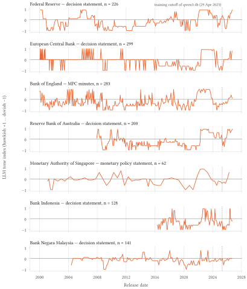
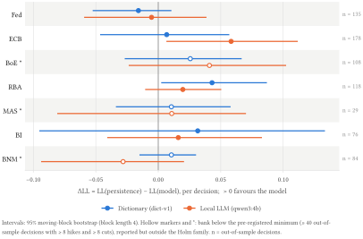
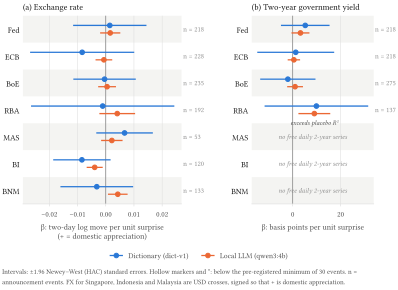
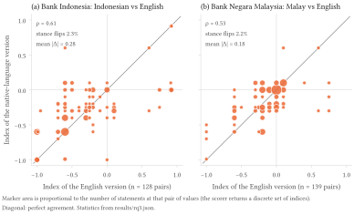
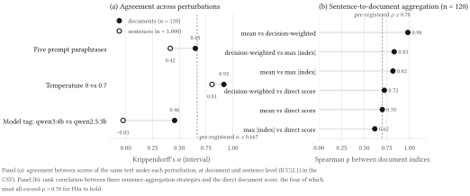
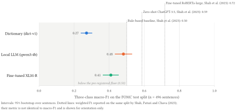

# Reading the Room: Do Local-LLM Tone Scores of Central-Bank Communication Carry Policy Signal? Pre-registered Evidence from Seven Central Banks in Three Languages

*Thanatchon Chongmankhong* · October 2026 · [PDF](https://github.com/thanatchon36/cbtone/blob/main/paper/paper.pdf) · [Markdown source](https://github.com/thanatchon36/cbtone/blob/main/paper/paper.md) · [`results/summary.json`](https://github.com/thanatchon36/cbtone/blob/main/results/summary.json)

!!! info "About this page"
    Generated by `make paper` from `paper/paper.md`. Every number is injected from
    `results/summary.json`; citations are numbered in order of first appearance
    (IEEE style) and link to the reference list at the end. The typeset version is
    the PDF.

## Abstract

Hawkish/dovish tone indices distilled from central-bank text are now routinely produced with large language
models (LLMs), yet it is rarely asked whether such indices carry information that a trivial forecast does not,
whether they survive a change of prompt, or whether the model has already seen the outcomes it is asked to
anticipate. We address these questions with a pre-registered study of seven central banks (the Federal Reserve,
the European Central Bank, the Bank of England, the Reserve Bank of Australia, the Monetary Authority of
Singapore, Bank Indonesia and Bank Negara Malaysia) in English, Indonesian and Malay, scored by a four-billion-parameter
model (`qwen3:4b`) running on consumer hardware. Hypotheses, thresholds, samples and multiple-testing
families were frozen in a public pre-registration before any scorer read the full corpus, and every LLM result
is re-estimated on entity-masked text and on a post-training-cutoff window. **Every testable hypothesis is
refuted at its pre-registered threshold.** Relative to a persistence forecast, LLM tone improves the
out-of-sample log-loss of the next policy decision at none of the 4 adequately powered
banks (the nearest miss is the ECB: ΔLL 0.058, Holm-adjusted
*p* = 0.13). The tone surprise explains the announcement-window
market move beyond a non-announcement placebo in 1 of 11
bank–market cells and never beats a cited dictionary after correction. Native-language and English versions of
the same statement agree only moderately in intensity (Spearman ρ = 0.61
for Indonesian, 0.53 for Malay, against a pre-registered 0.70), while
rarely disagreeing in direction. Scores move materially with the prompt wording (Krippendorff's α =
0.65 across five paraphrases at document level) and still more with the model
version. On the human-labelled FOMC test split the LLM reaches a macro-F1 of
0.48, above the dictionary (0.27)
but below the pre-registered floor of 0.50. We release the corpus pipeline, the scorers and the evaluation
harness as the open-source Python package `cbtone`, together with every number in this paper.

**Keywords:** central-bank communication; monetary policy; large language models; text as data; pre-registration; training-data contamination; Southeast Asia. **JEL:** E52, E58, C45, C55, G14.

> **Disclaimer.** This is an independent open-source project. It uses only documents published on central banks’ public websites (or public mirrors of them), represents the views of no institution, and is not investment advice. The author is employed by a central bank; nothing here draws on non-public information, and the text makes no comment on any bank’s policy choices, only on measurable properties of published text and on statistical results. The Bank of Thailand adapter is opt-in and excluded from all headline results.

## 1 Introduction
After every policy meeting a central bank publishes a decision statement and, in most cases, minutes and a press conference. Reducing that text to a scalar, a *tone* running from dovish to hawkish, has become a standard operation in academic research and in market practice. The first generation of measures counted words [\[1\]](#ref-lucca2009measuring), [\[2\]](#ref-apel2014informative); the second trained supervised classifiers on hand-labelled sentences [\[3\]](#ref-shah2023trillion); the third, now spreading rapidly, simply asks a large language model (LLM) to read the document and report a stance [\[4\]](#ref-hansen2023fedspeak), [\[5\]](#ref-silva2025text). The third generation is attractive because it needs no labelled data, no lexicon and no language-specific engineering, and because models small enough to run on a desktop now read economic prose fluently. It also raises three questions that the literature, overwhelmingly concerned with the Federal Reserve and the ECB and almost entirely with English, has not answered together.

The first question is whether the measurement carries *policy signal*: does knowing the tone of today’s statement improve a forecast of the next decision beyond what the last decision already implies, and does the unexpected component of tone explain the market’s reaction on the day? The second is whether the measurement is *stable*: a tone index is only a measurement if a harmless rephrasing of the prompt, or a point release of the model, leaves it substantially unchanged. The third is whether the measurement is *contaminated*: a model whose training data extend to 2025 has read commentary on the very decisions a historical test asks it to predict, so an apparently predictive score may be recall rather than reading [\[6\]](#ref-lopezlira2025memorization), [\[7\]](#ref-sarkar2024lookahead).

This paper answers all three for seven central banks in three languages, with a design that was fixed before the data were examined. The headline set comprises the Federal Reserve (Fed), the European Central Bank (ECB), the Bank of England (BoE), the Reserve Bank of Australia (RBA), the Monetary Authority of Singapore (MAS), Bank Indonesia (BI) and Bank Negara Malaysia (BNM). Three of the seven publish parallel native-language and English versions of their statements, which affords a direct test of cross-lingual consistency that, to our knowledge, has not been attempted for central-bank text. The scorer at the centre of the study is deliberately modest: `qwen3:4b`, a four-billion-parameter open-weight model served locally through Ollama, chosen because it is what an analyst at an institution without a cloud budget, or with a prohibition on sending documents to an external service, can actually run.

We make three contributions. First, we release `cbtone`, an Apache-licensed Python library that fetches public central-bank communications politely, versions them as a content-hashed corpus, and scores them with four scorer families (a cited hawkish/dovish dictionary, a finance-tuned transformer, a local LLM and a small fine-tuned multilingual encoder) behind a single interface, so that the comparisons below can be repeated or extended to other banks in a few lines of configuration. Second, we report a pre-registered study (git tag `prereg-v1`) in which the five research questions, their hypotheses and thresholds, the minimum sample per cell, the multiple-testing families and the placebo designs were frozen before any scorer read the full corpus; a result that fails its threshold is reported as refuted, not re-specified. Third, we treat training-data contamination as a first-class threat: every LLM result is re-estimated on *masked* text, in which bank, committee and instrument names, countries, dates and rate levels are replaced by placeholders, and on a *post-cutoff* window of documents released after the model’s public release date, and a finding is called robust only if it survives both.

The results are uniformly negative, and we think that is the paper’s value. LLM tone does not improve out-of-sample prediction of the next decision over a persistence baseline at any of the four adequately powered banks; the tone surprise explains the announcement-window move beyond its placebo in a single bank–market cell and never beats the dictionary after correction; native-language and English versions of the same statement correlate only moderately; and five paraphrases of the same prompt produce indices whose agreement falls short of the pre-registered reliability floor. The negative findings are sharpened rather than weakened by the contamination protocol, because masking leaves the point estimates almost unchanged: there is no memorised signal to remove. What the local LLM does do is read individual FOMC sentences better than a dictionary, which is consistent with the published literature and is precisely the kind of claim that does not generalise to policy signal without the tests reported here.

The remainder of the paper is organised as follows. Section 2 situates the study in the literature on tone measurement, LLM annotation and announcement effects. Section 3 describes the corpus, the decision and market data, and the labels. Section 4 sets out the pre-registered design. Sections 5 to 7 report the results on policy signal, on reliability and contamination, and on transfer to Southeast Asia. Section 8 discusses the findings, Section 9 the threats to validity, and Section 10 the reproducibility of every number; Section 11 concludes.

## 2 Related literature
### 2.1 Measuring the tone of central-bank text
The measurement of central-bank tone has moved from counting words to classifying them, and so far almost exclusively for the Federal Reserve. Lucca and Trebbi [\[1\]](#ref-lucca2009measuring) and Apel and Blix Grimaldi [\[2\]](#ref-apel2014informative) count hawkish and dovish terms in FOMC statements and Riksbank minutes respectively; Loughran and McDonald [\[8\]](#ref-loughran2011liability) show why generic sentiment lexicons mislead on financial text, and Picault and Renault [\[9\]](#ref-picault2017words) build a field-specific lexicon for the ECB. Tone dictionaries have also been applied to speeches to study the home bias of European central bankers [\[10\]](#ref-bennani2017home). Topic models exploit deliberation transcripts to separate information from forward guidance [\[11\]](#ref-hansen2016shocking) and to study how transparency changes what committee members say [\[12\]](#ref-hansen2018transparency), while voice-tone measures extend the lens beyond the written record [\[13\]](#ref-gorodnichenko2023voice). Supervised transformers came next: FOMC-RoBERTa, trained on 2,480 hand-labelled FOMC sentences, reaches a weighted F1 of 0.72 on the held-out split against about 0.50 for a rule-based baseline and 0.59 for zero-shot ChatGPT-3.5 [\[3\]](#ref-shah2023trillion), and CentralBankRoBERTa classifies economic sentiment rather than policy stance [\[14\]](#ref-pfeifer2023centralbankroberta). The Fed is also the only bank with a public human-labelled hawkish/dovish set, so outside the Fed no scorer has been checked against human judgement.

### 2.2 LLMs as annotators, and the contamination problem
Asking an LLM to annotate text works, but how well depends on the setting. LLM annotation can match or beat crowd workers on cost and agreement for political text [\[15\]](#ref-gilardi2023chatgpt); zero-shot reading of FOMC stance by an early GPT model is modest [\[4\]](#ref-hansen2023fedspeak); and the one study spanning many banks and languages finds a fine-tuned multilingual encoder far ahead of GPT-4o on stance classification [\[5\]](#ref-silva2025text). Models can also be probed for the expectations they hold [\[16\]](#ref-bybee2023surveying) and used to forecast returns from headlines [\[17\]](#ref-lopezlira2023chatgpt). Two reliability concerns follow directly. Prompt format alone can move accuracy by tens of points [\[18\]](#ref-sclar2024quantifying), and a recent application at the Reserve Bank of Australia stresses that “reasoning” about central-bank text must be made trustworthy before it is operationalised [\[19\]](#ref-jones2025ornithologist). Ludwig, Mullainathan and Rambachan [\[20\]](#ref-ludwig2025llm) give the econometric framing we adopt: an LLM output used as a regressor is a noisy, possibly non-classical measurement whose error structure must be characterised before downstream inference is interpreted.

Contamination is both real and measurable. LLMs recall macroeconomic outcomes almost perfectly before their training cutoff and at near-chance rates after it [\[6\]](#ref-lopezlira2025memorization); masking entity names changes GPT-based sentiment signals in-sample [\[21\]](#ref-glasserman2024lookahead); and formal tests of look-ahead bias in pretrained models are available [\[7\]](#ref-sarkar2024lookahead). We found no study that combines entity masking with a post-cutoff split on central-bank text, which is what our RQ4c does.

### 2.3 Announcement effects and the Southeast Asian evidence
The event-study template is well established. Kuttner [\[22\]](#ref-kuttner2001monetary) identifies the policy surprise from federal funds futures; Gürkaynak, Sack and Swanson [\[23\]](#ref-gurkaynak2005actions) separate a target factor from a “path” factor that captures what the statement says; Bernanke and Kuttner [\[24\]](#ref-bernanke2005explains) quantify the equity response; and Blinder et al. [\[25\]](#ref-blinder2008central) survey why communication moves markets. Text-based surprise measures explain much less of daily moves than rate surprises do; changes in statement wording reach a pseudo-R² of at most 0.12 [\[26\]](#ref-ehrmann2020starting). We therefore pre-registered small R² values as the relevant benchmark rather than as a disappointment. A recent Federal Reserve note comparing LLM and lexicon tone across many banks reports only moderate agreement between the two [\[27\]](#ref-xu2026assessing), which anticipates our RQ4 results.

Evidence for Southeast Asia is thin. For Malaysia there is a yield-curve event study of rate surprises [\[28\]](#ref-ho2021effects); for the region there are transparency surveys [\[29\]](#ref-filardo2008transparency); and the emerging-market communication literature more broadly covers Fed spillovers to emerging equity markets [\[30\]](#ref-hayo2012federal), the link between transparency and market expectations [\[31\]](#ref-neuenkirch2013transparency), and expectation formation in Brazil [\[32\]](#ref-montes2016communication). Singapore’s exchange-rate-centred regime is described by Parrado [\[33\]](#ref-parrado2004singapore), but we found no study linking MAS statement text to the Singapore dollar, and none comparing tone between native-language and English versions of the same central-bank document.

## 3 Data
### 3.1 Corpus
Adapters fetch each bank’s public pages under its robots.txt, with a rate limit of at least two seconds per host and a descriptive User-Agent, caching every response with its SHA-256 digest. MAS serves a bot interstitial to automated clients and pbc.gov.cn disallows crawlers; with the author’s approval both are read from Internet Archive copies and never from the banks’ own sites. The snapshot used here (`2026-10-14+ed5a49c28f7b41acaf4f21bda0d43570bd23049b363717c08d5efb3b9177bb8b`) holds 2,935 documents. Each bank’s primary decision series was fixed in the pre-registration: FOMC statements; ECB monetary-policy decision press releases; BoE Monetary Policy Committee minutes (the Bank’s 2000–2006 decision releases are a single sentence and carry no tone); RBA statements from December 2007 (earlier releases exist only when the cash rate changed); MAS Monetary Policy Statements; and BI and BNM statements (English primary, with Indonesian and Malay twins used for RQ3). Text is committed to the repository only where the source’s terms permit redistribution (Fed, ECB decision releases, RBA); for the other banks the repository holds URLs and hashes, and `make fetch` rebuilds the text locally.

### 3.2 Policy decisions
Rate decisions are taken from the BIS central-bank policy-rate series and matched to meeting dates from the corpus; a meeting at which the rate is unchanged is a hold. MAS sets a path for the trade-weighted exchange rate rather than an interest rate, so its decisions (tighten, maintain, ease) are taken from the Authority’s own published decision table; a rule-based extractor exists for statements not yet in that table, but its accuracy is development accuracy only and it is used for two 2026 statements that are excluded from every test.

### 3.3 Market data
Daily exchange-rate closes come from Yahoo Finance, with bad ticks removed by a rule fixed before any test was run, and two-year government-bond yields from a free official daily source where one exists (United States, euro area, United Kingdom, Australia). Moves are measured between the closes of *t* − 1 and *t* + 1 around the release; a document without a published release time is timed at 00:00 local time on its release date, so that the window always contains the event. Exchange rates for Singapore, Indonesia and Malaysia are USD crosses, signed so that a positive move is a domestic appreciation.

### 3.4 Human and silver labels
Human labels exist only for the Fed: the hawkish/dovish test split of Shah, Paturi and Chava [\[3\]](#ref-shah2023trillion), which is used for evaluation only under its non-commercial licence and never for training. For Southeast Asia, 200 sentences (MAS 60; BI 35 English and 35 Indonesian; BNM 35 English and 35 Malay) carry *silver* labels produced by two LLM passes with different prompts and a tie-break; they are reported as silver throughout and are never treated as ground truth. Table 1 summarises the sample behind every test.

**Table 1.** Sample behind each test. Decisions are meetings with a matched policy decision; OOS, hikes and cuts are the out-of-sample decisions predicted by the expanding-window model in RQ1 and the hikes and cuts among them (for MAS, tightenings and easings of the exchange-rate path). A bank is powered for RQ1 when it has at least 40 OOS decisions with at least 8 hikes and 8 cuts. FX and two-year-yield events are announcements with a usable market window; “—” marks series for which no free daily source exists.

| Bank | Primary document | Decisions | OOS | Hikes | Cuts | Powered (RQ1) | FX events | 2Y events |
|:---|:---|---:|---:|---:|---:|:--:|---:|---:|
| Fed | FOMC statement | 225 | 135 | 21 | 11 | yes | 218 | 218 |
| ECB | Decision press release | 298 | 178 | 15 | 23 | yes | 228 | 218 |
| BoE | MPC minutes | 180 | 108 | 5 | 9 | no | 235 | 275 |
| RBA | Decision statement | 198 | 118 | 16 | 12 | yes | 192 | 137 |
| MAS | Monetary Policy Statement | 59 | 29 | 7 | 6 | no | 53 | — |
| BI | Decision statement | 127 | 76 | 11 | 9 | yes | 120 | — |
| BNM | Decision statement | 140 | 84 | 7 | 7 | no | 133 | — |

## 4 Empirical design
### 4.1 Scorers
Every scorer returns a probability vector over {hawkish, dovish, neutral} and an index $`\tau = p_{\text{hawkish}} - p_{\text{dovish}} \in [-1, 1]`$, computed on the same input: the decision, forward-guidance, outlook and risk paragraphs of a document selected by a rule-based tagger and capped at 6,000 characters. The *dictionary* (`dict-v1`) applies a 167-term lexicon assembled from the cited hawkish/dovish word lists with negation handling; it reads English only. The *LLM* is `qwen3:4b` run locally through Ollama at temperature 0 with a registered prompt (P1) and schema-constrained JSON output; every call is cached by content hash, so a re-run repeats no inference. The *fine-tuned* scorer is XLM-R base trained for at most 30 minutes on the LLM’s own sentence labels for corpus sentences, never on the FOMC data, so that it measures how much of the LLM’s reading a small multilingual encoder can absorb. FOMC-RoBERTa, the in-distribution reference, is implemented but is a gated model whose access was pending at the time of the run; it is reported as not run wherever it appears.

### 4.2 Pre-registration and hypotheses
The pre-registration (`docs/RESEARCH_QUESTIONS.md` at tag `prereg-v1`) fixed the five research questions, the hypotheses in Table 2, the sample minimum for each (bank, question) cell, the Holm families and the placebo designs. Deviations made after the tag are logged with their rationale in `docs/DECISIONS.md` (D17–D20) and concern compute allocation and document selection, not thresholds or tests.

**Table 2.** Pre-registered hypotheses, their thresholds and the verdicts reported in Sections 5–7. Every verdict is read from `results/summary.json`.

| Hypothesis | Statement | Threshold | Verdict |
|:---|:---|:---|:---|
| H1 | LLM tone improves out-of-sample next-decision log-loss over persistence at a majority of powered banks | ΔLL \> 0, Holm-adjusted *p* \< 0.05, beats both placebos | refuted (0 of 4) |
| H2a | The LLM tone surprise explains the announcement-window move beyond a non-announcement placebo | R² above the placebo 95th percentile, Holm-adjusted *p*(β) \< 0.05 | refuted (1 of 11) |
| H2b | The LLM’s R² exceeds the dictionary’s | ΔR² \> 0, Holm-adjusted *p* \< 0.05 | refuted (0 of 11) |
| H3 | Native-language and English scores of the same statement agree | Spearman ρ ≥ 0.70 and stance flips ≤ 10 % | refuted |
| H4a | Scores are stable across prompt paraphrases, temperatures, model tags and aggregation | α ≥ 0.667, ICC(2,1) ≥ 0.75, all aggregation ρ ≥ 0.70 | prompts pass: no |
| H4b | The LLM agrees with human FOMC labels better than the dictionary | macro-F1 ≥ 0.50 and above the dictionary | refuted |
| H4c | Any H1/H2 finding survives entity masking and a post-cutoff split | both re-estimates keep sign and significance | robust finding: no |
| H5 | Fed-calibrated scorers transfer poorly to MAS | silver macro-F1 drop ≥ 0.15 vs FOMC, with FOMC-RoBERTa as the reference | untestable |

### 4.3 Next-decision prediction (RQ1)
For each bank $`b`$ with decisions $`y_t \in \{\text{cut}, \text{hold}, \text{hike}\}`$ at meetings $`t = 1, \dots, T_b`$, an ordered-logit model
``` math
\Pr(y_{t+1} \le k \mid x_t) = \Lambda(\kappa_k - x_t'\beta), \qquad x_t = (\tau_t,\; \Delta\tau_t,\; d_t),
```
is refitted at every decision on an expanding window (initial 40 % of the sample, at least 30 decisions) and used to predict the next decision, where $`\tau_t`$ is the tone of the document released at $`t`$, $`\Delta\tau_t`$ its change from the previous document and $`d_t`$ the direction of the last decision. The baseline is persistence, a smoothed estimate of $`\Pr(y_{t+1} \mid y_t)`$ from the same window. Performance is the multiclass log-loss per decision, and the quantity of interest is the gain
``` math
\Delta\mathrm{LL}_b = \mathrm{LL}_b^{\text{reference}} - \mathrm{LL}_b^{\text{model}},
```
positive when the tone model is better. Its sampling distribution is obtained by a moving-block bootstrap over out-of-sample decisions (block length 4); Holm’s correction is applied across the adequately powered banks; and a success additionally requires the real gain to exceed the 95th percentile of two placebo distributions, obtained by shuffling the dates of the tone series and by permuting the decision labels (1,000 permutations each). The same procedure is run with the dictionary as the reference, so that the LLM is compared both with a trivial forecast and with a simple text measure.

### 4.4 Announcement-window regressions (RQ2)
The tone surprise $`s_t = \tau_t - \hat{\tau}_{t \mid t-1}`$ is the residual from an AR(1) fitted to the tone series of that bank using documents released before $`t`$ only. For each bank and market series the two-day move $`r_t`$ around the release is regressed on the surprise,
``` math
r_t = \alpha + \beta s_t + \varepsilon_t,
```
with Newey–West (HAC) standard errors. H2a requires the R² to exceed the 95th percentile of the same regression run on non-announcement days and a Holm-adjusted one-sided test on $`\beta`$ in the hypothesised direction (a hawkish surprise appreciates the currency and raises the two-year yield); H2b compares the LLM’s R² with the dictionary’s by paired block bootstrap. Cells with fewer than 30 events are reported but excluded from the Holm family.

### 4.5 Cross-lingual consistency (RQ3)
For BI and BNM every statement is published in the national language and in English. The LLM scores both versions independently, and consistency is measured by the Spearman correlation of the two indices over parallel pairs and by the *stance-flip rate*, the share of pairs whose argmax labels are hawkish in one language and dovish in the other. H3 requires ρ ≥ 0.70 and a flip rate of at most 10 %. PBoC, which publishes Chinese and English, is exploratory because it has too few parallel pairs.

### 4.6 Reliability (RQ4a, RQ4b)
Stability is measured with Krippendorff’s α (interval) and ICC(2,1) across five registered paraphrases of the prompt, two temperatures (0 and 0.7), two model tags (`qwen3:4b` and `qwen2.5:3b`) and three strategies for aggregating sentence scores into a document score (mean, decision-weighted, maximum absolute index), each compared with the direct document score, on 120 documents and 1,000 sentences. Agreement with human labels is the three-class macro-F1 on the 496-sentence FOMC test split, with a bootstrap interval over sentences and a paired comparison with the dictionary.

### 4.7 Contamination (RQ4c)
Every LLM score is recomputed on *masked* text, in which a deterministic rule replaces the names of banks, committees, instruments and countries, all dates and all rate levels with typed placeholders, and every RQ1 and RQ2 estimate is recomputed on the *post-cutoff* window of documents released after the model’s public release date (2025-04-29). A finding from RQ1 or RQ2 is *robust* only if it keeps its sign and significance under both re-estimations. Because the model cannot have read commentary on post-cutoff decisions, and because masking removes the handles through which a memorised outcome could be retrieved, a signal that survives both is unlikely to be recall.

### 4.8 Transfer to Southeast Asia (RQ5)
Each Fed-calibrated scorer’s macro-F1 on the FOMC test split is compared with its macro-F1 on the silver sets per bank and language; H5 predicts a drop of at least 0.15 for MAS, whose exchange-rate framing is furthest from the Fed’s. The test was pre-registered with FOMC-RoBERTa as the reference scorer and a minimum of 50 sentences per cell. As a descriptive complement, we report the mean cosine distance between each bank’s sentences and Fed sentences in a multilingual sentence-embedding space (`sentence-transformers/paraphrase-multilingual-MiniLM-L12-v2`).

### 4.9 Power, multiplicity and compute
Each (bank, question) cell has a pre-set minimum sample; underpowered cells are reported with their estimates but excluded from the Holm families and from majority counts, and a majority verdict requires at least three powered banks. All LLM scores come from one backend, the same `qwen3:4b` weights (digest `359d7dd4`) served by Ollama on a desktop RTX 4070 Ti, on which the full pre-registered workload fits the two-hour LLM budget without invoking the pre-registered compute ladder: scoring the primary documents took 4 minutes, the masked re-scoring 3 minutes and the stability perturbations 71 minutes. The fine-tuned encoder trained in 6 minutes on an Apple M4 laptop. On that laptop the LLM processes about 220 prompt tokens per second, roughly 3.5 seconds per document at a 3,000-character cap, so a laptop-only replication requires the ladder described in Section 10.

## 5 Results: policy signal
### 5.1 The tone series
Figure 1 plots the LLM index of each bank’s primary document over the sample. The series are visibly plausible: the 2022–2023 tightening cycle appears as a sustained hawkish plateau at every bank that publishes a full statement, the 2008–2009 and 2020 easings as dovish troughs, and the exchange-rate-framed MAS statements as a smoother and more muted series. Two features matter for what follows. First, the ECB’s decision press releases before 2016 are short and formulaic, so the index alternates between neutral and the extremes rather than evolving gradually; second, for BI the series begins only in 2016, because the bank’s own index lists nothing older. Plausibility of this kind is the weakest test a tone index can pass, and the sections that follow ask whether anything more is true.

<figure>

<figcaption aria-hidden="true">Figure 1. LLM tone index of each bank’s primary decision document, <code>qwen3:4b</code> at temperature 0 with the registered prompt. Dotted line: the model’s public release date, after which no document can have been in its training data.</figcaption>
</figure>

### 5.2 Does tone predict the next decision? (RQ1)
**H1 is refuted.** 4 banks meet the pre-registered power rule (Fed, ECB, RBA and BI). The LLM succeeds at none of them (Table 3, Figure 2).

**Table 3.** Next-decision prediction with LLM tone at the adequately powered banks. ΔLL = LL(reference) − LL(model) in multiclass log-loss per decision; positive favours the LLM. Intervals from a moving-block bootstrap; Holm correction across the four banks.

| Bank | OOS *n* | ΔLL vs persistence \[95 % CI\] | Holm *p* | ΔLL vs dictionary \[95 % CI\] | Beats both placebos |
|:---|---:|---:|---:|---:|:--:|
| Fed | 135 | -0.005 \[-0.059, 0.039\] | 1.00 | 0.011 \[-0.041, 0.063\] | no |
| ECB | 178 | 0.058 \[0.007, 0.112\] | 0.13 | 0.052 \[-0.000, 0.108\] | yes |
| RBA | 118 | 0.020 \[-0.010, 0.050\] | 0.56 | -0.023 \[-0.058, 0.014\] | no |
| BI | 76 | 0.016 \[-0.041, 0.083\] | 1.00 | -0.016 \[-0.103, 0.095\] | no |

The ECB is the only bank at which the LLM’s gain over persistence has a bootstrap interval that excludes zero and exceeds both placebo distributions (95th percentiles 0.014 for shuffled tone and 0.010 for permuted labels); the unadjusted *p*-value is 0.032 and the Holm-adjusted value 0.13, so the finding does not survive the pre-registered correction. The masked LLM gives an almost identical ECB estimate (0.059 \[0.008, 0.111\]), which is consistent with the gain being a property of the text rather than of memorised outcomes, but does not rescue it. At the RBA it is the dictionary, not the LLM, whose interval lies above zero (ΔLL 0.043 \[0.002, 0.087\]); the dictionary was not a registered hypothesis and we report it only as a reminder that the ranking of scorers is bank-specific. The BoE (only 5 out-of-sample hikes), MAS (29 predictions) and BNM (7 hikes) are underpowered and appear in Figure 2 with hollow markers.

Two further observations qualify the headline. Ranking metrics are high for every scorer, including the persistence baseline (Fed persistence AUROC 0.77, ECB 0.85), because most of the information about the next move is already in the last one: policy rates move in runs, and a model that knows the direction of the last decision ranks the next correctly most of the time. The LLM raises the ECB AUROC to 0.91, which is the same near-miss seen in log-loss. Second, BI’s masked-text AUROC of exactly 1.00 rests on 11 hikes and 9 cuts and is a small-sample artefact discussed in `ANOMALIES.md` (A9), not evidence of perfect ranking.

<figure>

<figcaption aria-hidden="true">Figure 2. Gain in next-decision log-loss over persistence by bank and scorer. Positive values favour the text model. Hollow markers: banks below the pre-registered power minimum, reported but outside the Holm family.</figcaption>
</figure>

### 5.3 Does the tone surprise explain the market reaction? (RQ2)
**H2a and H2b are refuted.** Of 11 adequately powered bank–market cells, the LLM tone surprise explains the release-window move beyond its placebo in 1 (Table 4, Figure 3), and its R² exceeds the dictionary’s, after Holm correction, in 0.

**Table 4.** Announcement-window regressions of the market move on the LLM tone surprise, all powered cells. FX β is the signed two-day log move (positive = domestic appreciation) per unit surprise; yield β is in basis points per unit surprise. Newey–West standard errors; Holm correction across the eleven cells.

| Bank | Series | *n* | β | R² | Placebo R² (p95) | Holm *p* (β) | ΔR² vs dict. | Exceeds placebo |
|:---|:---|---:|---:|---:|---:|---:|---:|:--:|
| Fed | USD index | 218 | 0.0016 | 0.003 | 0.018 | 1.00 | 0.003 | no |
| Fed | US 2Y | 218 | 3.25 | 0.014 | 0.019 | 0.40 | 0.008 | no |
| ECB | EUR/USD | 228 | -0.0007 | 0.001 | 0.017 | 1.00 | -0.001 | no |
| ECB | EA 2Y | 218 | 0.51 | 0.001 | 0.018 | 1.00 | 0.001 | no |
| BoE | GBP/USD | 235 | 0.0005 | 0.000 | 0.018 | 1.00 | 0.000 | no |
| BoE | UK 2Y | 275 | 1.00 | 0.002 | 0.016 | 1.00 | 0.002 | no |
| RBA | AUD/USD | 192 | 0.0041 | 0.012 | 0.019 | 0.83 | 0.012 | no |
| RBA | AU 2Y | 137 | 9.04 | 0.100 | 0.029 | 0.04 | 0.088 | yes |
| MAS | USD/SGD | 53 | 0.0022 | 0.029 | 0.074 | 0.92 | 0.004 | no |
| BI | USD/IDR | 120 | -0.0039 | 0.064 | 0.031 | 1.00 | 0.046 | no |
| BNM | USD/MYR | 133 | 0.0043 | 0.027 | 0.029 | 0.08 | 0.025 | no |

The single success is the Australian two-year yield: a one-unit hawkish surprise is associated with a 9.0 basis-point rise (R² 0.10 against a placebo 95th percentile of 0.029). Its R² gain over the dictionary has a bootstrap interval above zero (\[0.001, 0.225\]) but a Holm-adjusted *p* of 0.43, so H2b fails even there. The magnitude is economically sensible: the R² is of the order reported for wording-based surprises in the literature [\[26\]](#ref-ehrmann2020starting), and far below what rate surprises achieve [\[23\]](#ref-gurkaynak2005actions). For BI the LLM coefficient is statistically distinguishable from zero but carries the sign opposite to the hypothesis (β -0.0039, unadjusted *p* 0.007): more hawkish surprises coincide with rupiah depreciation over the day-level window. The pre-registered one-sided test does not count this as a success, and because BI publishes no release time the design cannot distinguish a reaction from the statement from a statement that responds to the day’s market move (`ANOMALIES.md`, A10). Pooled across banks with bank fixed effects, the FX coefficient is 0.0005 \[-0.0010, 0.0020\] (*n* = 1,179), indistinguishable from zero.

<figure>

<figcaption aria-hidden="true">Figure 3. Response of the exchange rate (a) and the two-year government yield (b) to the tone surprise, by bank and scorer, with Newey–West 95 % intervals. The Australian two-year yield is the only cell in which the LLM’s R² exceeds its non-announcement placebo.</figcaption>
</figure>

### 5.4 Do native-language and English versions agree? (RQ3)
**H3 is refuted.** On parallel statements the LLM’s native-language and English indices have a Spearman correlation of 0.61 for BI (Indonesian, *n* = 128) and 0.53 for BNM (Malay, *n* = 139), both below the pre-registered 0.70. The disagreement concerns intensity rather than direction: the stance flips between hawkish and dovish in only 2.3% and 2.2% of pairs, well within the 10 % ceiling, whereas the mean absolute gap between the two indices is 0.28 and 0.18 on a \[−1, 1\] scale (Figure 4). The fine-tuned multilingual encoder is no more consistent (ρ 0.44 and 0.54), which suggests that the inconsistency is not peculiar to generative decoding. The dictionary is English-only and therefore not applicable, and PBoC, with 9 parallel pairs, is exploratory. Figure 4 makes the structure of the disagreement visible: both languages place most statements in a mildly dovish band, but the Indonesian versions are read as more dovish than the English ones in the lower-left quadrant, and the Malay versions cluster more tightly around neutral.

<figure>

<figcaption aria-hidden="true">Figure 4. LLM tone of the native-language version against the English version of the same statement, for Bank Indonesia (a) and Bank Negara Malaysia (b). Marker area is proportional to the number of statements at each pair of values; the diagonal is perfect agreement.</figcaption>
</figure>

## 6 Results: reliability and contamination
### 6.1 Stability across prompts, temperatures, model versions and aggregation (H4a)
**H4a is refuted.** Table 5 and Figure 5 report Krippendorff’s α and ICC(2,1) for each perturbation. Across the five registered prompt paraphrases, document scores reach α = 0.65 and ICC(2,1) = 0.66 on 120 documents, short of the pre-registered 0.667 and 0.75; on 1,000 sentences α falls to 0.42. Temperature matters much less (α = 0.92 for documents and 0.81 for sentences at 0 against 0.7), which indicates that the instability is not sampling noise but a genuine dependence of the reading on the wording of the instruction. Replacing the model tag with `qwen2.5:3b` changes scores most of all: α = 0.46 for documents and -0.03 for sentences, the latter no better than chance agreement. Aggregating sentence scores into a document score yields indices that correlate with the direct document score at ρ between 0.62 and 0.72, so not every pair of strategies clears 0.70; the mean and decision-weighted aggregates are near-identical to each other (ρ = 0.98), as they must be by construction (`ANOMALIES.md`, A11).

**Table 5.** Agreement between scores of the same text under each perturbation, on 120 documents and 1,000 sentences; α is Krippendorff’s interval α and ICC is ICC(2,1). Pre-registered floors: α ≥ 0.667 and ICC(2,1) ≥ 0.75. 982 of the 1,000 sentences have a complete set of prompt scores; the remainder returned malformed JSON in at least one paraphrase and are treated as missing.

| Perturbation | α (documents) | ICC (documents) | α (sentences) | ICC (sentences) |
|:---|---:|---:|---:|---:|
| Five prompt paraphrases | 0.65 | 0.66 | 0.42 | 0.43 |
| Temperature 0 vs 0.7 | 0.92 | 0.92 | 0.81 | 0.81 |
| Model tag, `qwen3:4b` vs `qwen2.5:3b` | 0.46 | 0.52 | -0.03 | 0.21 |

The practical reading is that a tone index from a small local model is, in part, a property of the prompt and of the model version. Two analysts using different but equally reasonable instructions will obtain series that agree only moderately, and a series computed before and after a model upgrade is not the same measurement. The low agreement between LLM and lexicon tone reported across many banks by Xu and Vilán [\[27\]](#ref-xu2026assessing) is of the same order as our prompt-paraphrase α, which suggests that the choice of prompt is as consequential as the choice between an LLM and a dictionary.

<figure>

<figcaption aria-hidden="true">Figure 5. Stability of the LLM index. (a) Krippendorff’s α between scores of the same text under each perturbation, at document and sentence level. (b) Spearman correlation between the three sentence-aggregation strategies and the direct document score.</figcaption>
</figure>

### 6.2 Agreement with human labels (H4b)
**H4b is refuted.** On the 496-sentence FOMC test split the LLM’s three-class macro-F1 is 0.48 \[0.43, 0.53\] (Table 6, Figure 6). It exceeds the dictionary’s by 0.21 \[0.16, 0.26\], a difference whose interval lies well away from zero, but it misses the pre-registered floor of 0.50, so the hypothesis fails on its first clause. The fine-tuned XLM-R, trained only on the LLM’s labels for corpus sentences and never on FOMC data, reaches 0.41 \[0.36, 0.45\], which shows that a 270-million-parameter encoder can absorb most of the LLM’s reading at a fraction of the inference cost.

**Table 6.** Three-class macro-F1 on the FOMC test split (496 sentences), with bootstrap intervals over sentences. Pre-registered floor 0.50.

| Scorer                 |  Macro-F1 \[95 % CI\] | Δ vs dictionary \[95 % CI\] |
|:-----------------------|----------------------:|----------------------------:|
| Dictionary (`dict-v1`) |   0.27 \[0.24, 0.30\] |                           — |
| Local LLM (`qwen3:4b`) |   0.48 \[0.43, 0.53\] |         0.21 \[0.16, 0.26\] |
| Fine-tuned XLM-R       |   0.41 \[0.36, 0.45\] |         0.14 \[0.09, 0.19\] |
| FOMC-RoBERTa           | not run (gated model) |                           — |

Our dictionary scores 0.27, well below the roughly 0.50 reported for a rule-based baseline by Shah, Paturi and Chava [\[3\]](#ref-shah2023trillion). The two rule sets differ, and ours returns neutral whenever hawkish and dovish matches balance or neither appears, which is the case for almost every FOMC test sentence; the dictionary is therefore a floor rather than a competitive baseline on sentence-level data, even though it is competitive on document-level prediction (Section 5.2). The LLM also over-predicts the neutral class relative to the human labels, which depresses its macro-F1 relative to its accuracy. FOMC-RoBERTa, the in-distribution reference at about 0.72, could not be run.

<figure>

<figcaption aria-hidden="true">Figure 6. Agreement with human labels on the FOMC test split: three-class macro-F1 with 95 % bootstrap intervals. Shaded region: below the pre-registered floor. Dotted lines: weighted F1 values published for the same split, shown for orientation.</figcaption>
</figure>

### 6.3 Contamination (H4c)
No RQ1 or RQ2 finding is robust, for the simple reason that none is established in the first place. Table 7 reports the pooled estimates on original text, on masked text and on the post-cutoff window. Pooled across the powered banks, the LLM’s log-loss gain over the dictionary is 0.007 \[-0.016, 0.031\] on original text and 0.004 \[-0.017, 0.028\] on masked text: there is no effect to preserve, so the masked check cannot pass. The post-cutoff window (after 2025-04-29) holds 58 decisions and 78 FX events; its estimates overlap the full-sample intervals but are too wide to be informative on their own.

**Table 7.** Contamination protocol. The same pooled quantities re-estimated on entity-masked text and on documents released after the model’s public release date; *n* is given for the original, masked and post-cutoff estimates in turn.

| Quantity | Original text | Masked text | Post-cutoff window |
|:---|---:|---:|---:|
| RQ1: pooled ΔLL, LLM vs dictionary \[95 % CI\] (*n* = 728 / 728 / 58) | 0.007 \[-0.016, 0.031\] | 0.004 \[-0.017, 0.028\] | 0.055 \[-0.038, 0.185\] |
| RQ2: pooled FX β with bank fixed effects \[95 % CI\] (*n* = 1,179 / 1,179 / 78) | 0.0005 \[-0.0010, 0.0020\] | 0.0002 \[-0.0012, 0.0016\] | 0.0003 \[-0.0037, 0.0042\] |

The informative part of the exercise is what masking does to the point estimates: almost nothing. The ECB gain is 0.058 on original and 0.059 on masked text, and the pooled FX coefficient moves from 0.0005 to 0.0002. Had the LLM been retrieving memorised outcomes through the names and dates in the text, removing them would have degraded the original-text estimates; it does not. This is consistent with, though it does not prove, the absence of outcome memorisation in a four-billion-parameter model reading statements of this kind, and it implies that the negative results above are not an artefact of contamination either.

## 7 Transfer to Southeast Asia
**H5 is untestable as pre-registered.** The hypothesis requires FOMC-RoBERTa, which could not be run, and the BI-English and BNM-English silver subsets have 35 sentences each, below the pre-registered minimum of 50. Table 8 reports the descriptive comparison for completeness. On the 60 MAS silver sentences the dictionary’s macro-F1 is 0.36 against 0.27 on FOMC sentences, so it does not lose performance on MAS (drop -0.09). The LLM and the fine-tuned encoder score *higher* on the silver sets than on the human FOMC labels (0.64 and 0.67 on MAS), but the silver labels were produced by the same model family, so these numbers measure self-agreement rather than accuracy and support no claim about transfer. The two silver passes agree on 71% of sentences, and the silver distribution is skewed towards dovish and neutral (80 dovish, 17 hawkish, 103 neutral of 200).

**Table 8.** Descriptive transfer comparison. Silver macro-F1 is against LLM-produced silver labels and, for the LLM and the fine-tuned encoder, measures self-agreement rather than accuracy. Drop = FOMC macro-F1 − silver macro-F1; the pre-registered hypothesis predicts a drop of at least 0.15 for MAS.

| Scorer | Set | *n* | Silver macro-F1 | FOMC macro-F1 | Drop | Powered |
|:---|:---|---:|---:|---:|---:|:--:|
| Dictionary | MAS, English | 60 | 0.36 | 0.27 | -0.09 | yes |
| Dictionary | BI, English | 35 | 0.28 | 0.27 | -0.01 | no |
| Dictionary | BNM, English | 35 | 0.21 | 0.27 | 0.06 | no |
| Local LLM | MAS, English | 60 | 0.64 | 0.48 | -0.16 | yes |
| Local LLM | BI, English | 35 | 0.63 | 0.48 | -0.15 | no |
| Local LLM | BI, Indonesian | 35 | 0.44 | 0.48 | 0.05 | no |
| Local LLM | BNM, English | 35 | 0.69 | 0.48 | -0.21 | no |
| Local LLM | BNM, Malay | 35 | 0.63 | 0.48 | -0.15 | no |
| Fine-tuned XLM-R | MAS, English | 60 | 0.67 | 0.41 | -0.27 | yes |
| Fine-tuned XLM-R | BI, Indonesian | 35 | 0.46 | 0.41 | -0.05 | no |
| Fine-tuned XLM-R | BNM, Malay | 35 | 0.49 | 0.41 | -0.08 | no |
| FOMC-RoBERTa | — | — | not run (gated model) | — | — | — |

In the multilingual sentence-embedding space, MAS sentences are the farthest from Fed sentences (mean cosine distance 0.58, against 0.54 for the ECB and 0.43 within the Fed’s own sentences), consistent with the distinct vocabulary of an exchange-rate-centred regime [\[33\]](#ref-parrado2004singapore). Whether that distance translates into a loss of accuracy for a Fed-calibrated scorer remains, on this evidence, an open question that the pending reference model and a larger human-labelled set would settle.

## 8 Discussion
Four findings deserve interpretation beyond the verdicts.

*Persistence is the baseline to beat, and it is a strong one.* Most of what can be predicted about the next decision is in the last decision, because policy rates move in runs. The ordered-logit model with tone, its change and the last direction never beats a smoothed persistence forecast after correction, and the one near-miss, the ECB, has an unadjusted *p* of 0.032 across 178 out-of-sample decisions. This is not a statement that statements are uninformative; it is a statement that the information a small LLM extracts from them, compressed to a scalar, adds little to a trivial forecast of the *direction* of the next move. Text may well inform the size and timing of moves, or the probability of a change at all, none of which the pre-registered test measures.

*The announcement-window result is of the expected order.* The Australian two-year yield responds to the tone surprise by about 9 basis points per unit of surprise, with an R² near 0.10. That is the magnitude the wording-based literature leads one to expect [\[26\]](#ref-ehrmann2020starting), an order of magnitude below the explanatory power of rate surprises [\[23\]](#ref-gurkaynak2005actions). The pre-registration anticipated small R² values and set the bar at beating a placebo rather than at a size; one cell in eleven cleared it, which after correction for eleven tests is what chance would deliver. We do not think the Australian result is spurious, but we also cannot claim it.

*Cross-lingual disagreement is about intensity, not sign.* The LLM reads the Indonesian and Malay versions of a statement as pointing the same way as the English version in roughly 98 % of cases, but assigns different strengths. For an analyst who needs a categorical stance this is reassuring; for one who needs an index it means that the native-language and English series are not interchangeable, and that the choice of language is a modelling decision to be reported. The fine-tuned encoder shows the same pattern, so the disagreement is not an artefact of generative decoding; it is more plausibly a property of how a small multilingual model represents evaluative language in the two tongues.

*Prompt dependence is the binding reliability constraint.* The agreement between five paraphrases of the same instruction (α = 0.65 at document level) is lower than the agreement between temperatures and comparable to the agreement between an LLM and a lexicon reported elsewhere [\[27\]](#ref-xu2026assessing). In the framework of Ludwig, Mullainathan and Rambachan [\[20\]](#ref-ludwig2025llm), the LLM index is a measurement with substantial and possibly non-classical error, and the magnitude of that error depends on a design choice that is rarely reported. The implication for practice is direct: a tone series is a measurement only when the prompt and the model digest are frozen and logged, and a change in either is a change of instrument.

What, then, is a local LLM good for? It reads individual sentences better than a dictionary, with a macro-F1 that is close to the pre-registered floor and above the rule-based figure in the published literature; it produces series that track the broad policy cycle; and it does so in seconds per document, on hardware that costs less than a year of a commercial data subscription, with no text leaving the machine. These are the properties of a monitoring aid. They are not, on this evidence, the properties of a forecasting or trading signal, and the contamination protocol shows that the absence of signal is not because the model has been prevented from cheating.

## 9 Threats to validity
- **Small samples for Southeast Asian banks.** BI’s text begins in April 2016 because the bank’s own index lists nothing older; BNM changes its rate rarely; MAS met only twice a year until 2024. Several cells therefore fall below the pre-registered minimum and are reported as underpowered rather than tested, and the study is correspondingly less informative about the region than about the four large banks.
- **Silver labels.** The Southeast Asian evaluation set is labelled by the same model family as the LLM scorer. The LLM’s own silver score is reported but is used for no hypothesis, and the fine-tuned encoder’s silver score inherits the same circularity.
- **A short post-cutoff window.** The model’s public release date is late in the sample, so the post-cutoff check is wide and often inconclusive; an inconclusive check means a finding is *not established as robust*, which is the conservative reading.
- **Document selection.** One primary series per bank; the BoE uses minutes because its early decision releases carry no text; the RBA series starts in December 2007. A different choice of document could give different tone series, which the library makes easy to test but this paper does not.
- **Timing.** MAS and BI publish no release time, so their event windows span the whole release day and cannot separate the market’s reaction to the statement from the statement’s reaction to the market.
- **MAS decisions.** Taken from the Authority’s own table; the rule-based extractor’s accuracy is development accuracy only and affects two 2026 statements that are excluded from every test.
- **Gated reference model.** FOMC-RoBERTa could not be run, which makes H5 untestable as pre-registered and leaves the in-distribution reference for H4b to the published literature.
- **Compute and model scale.** The four-billion-parameter model is far smaller than hosted frontier models. The results speak to what an analyst can run on local hardware, not to the capabilities of the largest models; a frontier model might pass tests this one fails, and might also be more contaminated.

## 10 Reproducibility
All code is released under the Apache-2.0 licence at <https://github.com/thanatchon36/cbtone> and on PyPI as `cbtone`. `make reproduce` rebuilds every table and figure from the committed corpus snapshot; LLM scores are cached by content hash, so a re-run repeats only the few calls that failed the first time, while the fine-tuned encoder is retrained, which on Apple MPS is not bit-for-bit deterministic (`ANOMALIES.md`, A13). The pre-registration is the git tag `prereg-v1`; every later deviation is listed in `docs/DECISIONS.md` (D17–D20) and every data anomaly in `docs/ANOMALIES.md`. LLM scores were computed on a desktop RTX 4070 Ti (D20); the fine-tuned encoder was trained on an Apple M4 laptop (16 GB, MPS). Per-stage wall time is in `results/timing.json` and the hardware and software manifest in `results/hardware.json`. Every number in this paper, including those in the abstract, is injected from `results/summary.json` at build time (`paper/build.py`); none is typed by hand. A fresh-clone reproduction on 14 October 2026 completed in 23 minutes with no change to any verdict.

## 11 Conclusion
A small open-weight language model running on a consumer graphics card produces hawkish/dovish tone indices for seven central banks in three languages that look plausible over time and agree with human FOMC labels better than a dictionary. On every pre-registered test of *policy signal*, next-decision prediction, announcement-window reaction, cross-lingual consistency and prompt stability, the evidence is negative or underpowered, and the entity-masking and post-cutoff checks show that the negative result is not an artefact of contamination. Three lessons follow for practitioners. First, persistence is a strong baseline for decision prediction, and gains from text are small and bank-specific. Second, LLM tone depends on the prompt and on the model version, so a single-prompt index should not be treated as a measurement without a stability check, and the prompt and model digest should be reported as part of the measurement. Third, for Southeast Asian banks the binding constraint is sample size, which no improvement in the scorer can relax. The library, the masked and post-cutoff checks, and every number in this paper can be regenerated with a single command; we hope that the design, rather than the particular model, is what is reused.

## References

<div id="refs" class="references csl-bib-body" entry-spacing="0">

<div id="ref-lucca2009measuring" class="csl-entry">

<span class="csl-left-margin">\[1\] </span><span class="csl-right-inline">D. O. Lucca and F. Trebbi, “Measuring central bank communication: An automated approach with application to FOMC statements,” National Bureau of Economic Research, Working Paper 15367, 2009. doi: [10.3386/w15367](https://doi.org/10.3386/w15367).</span>

</div>

<div id="ref-apel2014informative" class="csl-entry">

<span class="csl-left-margin">\[2\] </span><span class="csl-right-inline">M. Apel and M. Blix Grimaldi, “How informative are central bank minutes?” *Review of Economics*, vol. 65, no. 1, pp. 53–76, 2014, doi: [10.1515/roe-2014-0104](https://doi.org/10.1515/roe-2014-0104).</span>

</div>

<div id="ref-shah2023trillion" class="csl-entry">

<span class="csl-left-margin">\[3\] </span><span class="csl-right-inline">A. Shah, S. Paturi, and S. Chava, “Trillion dollar words: A new financial dataset, task & market analysis,” in *Proceedings of the 61st <span class="nocase">Annual Meeting of the Association for Computational Linguistics</span> (Volume 1: Long Papers)*, Toronto, Canada: Association for Computational Linguistics, 2023, pp. 6664–6679. doi: [10.18653/v1/2023.acl-long.368](https://doi.org/10.18653/v1/2023.acl-long.368).</span>

</div>

<div id="ref-hansen2023fedspeak" class="csl-entry">

<span class="csl-left-margin">\[4\] </span><span class="csl-right-inline">A. L. Hansen and S. Kazinnik, “Can ChatGPT decipher Fedspeak?” Federal Reserve Bank of Richmond (SSRN working paper), 2023. Available: <https://papers.ssrn.com/sol3/papers.cfm?abstract_id=4399406></span>

</div>

<div id="ref-silva2025text" class="csl-entry">

<span class="csl-left-margin">\[5\] </span><span class="csl-right-inline">T. C. Silva, K. Moriya, and R. M. Veyrune, “From text to quantified insights: A large-scale LLM analysis of central bank communication,” International Monetary Fund, IMF Working Paper WP/2025/109, 2025. doi: [10.5089/9798229013802.001](https://doi.org/10.5089/9798229013802.001).</span>

</div>

<div id="ref-lopezlira2025memorization" class="csl-entry">

<span class="csl-left-margin">\[6\] </span><span class="csl-right-inline">A. Lopez-Lira, Y. Tang, and M. Zhu, “The memorization problem: Can we trust LLMs’ economic forecasts?” *arXiv:2504.14765*, 2025, Available: <https://arxiv.org/abs/2504.14765></span>

</div>

<div id="ref-sarkar2024lookahead" class="csl-entry">

<span class="csl-left-margin">\[7\] </span><span class="csl-right-inline">S. K. Sarkar and K. Vafa, “Lookahead bias in pretrained language models,” 2024. Available: <https://conference.nber.org/conf_papers/f205530/f205530.pdf></span>

</div>

<div id="ref-loughran2011liability" class="csl-entry">

<span class="csl-left-margin">\[8\] </span><span class="csl-right-inline">T. Loughran and B. McDonald, “When is a liability not a liability? Textual analysis, dictionaries, and 10-ks,” *The Journal of Finance*, vol. 66, no. 1, pp. 35–65, 2011, doi: [10.1111/j.1540-6261.2010.01625.x](https://doi.org/10.1111/j.1540-6261.2010.01625.x).</span>

</div>

<div id="ref-picault2017words" class="csl-entry">

<span class="csl-left-margin">\[9\] </span><span class="csl-right-inline">M. Picault and T. Renault, “Words are not all created equal: A new measure of ECB communication,” *Journal of International Money and Finance*, vol. 79, pp. 136–156, 2017, doi: [10.1016/j.jimonfin.2017.09.005](https://doi.org/10.1016/j.jimonfin.2017.09.005).</span>

</div>

<div id="ref-bennani2017home" class="csl-entry">

<span class="csl-left-margin">\[10\] </span><span class="csl-right-inline">H. Bennani and M. Neuenkirch, “The (home) bias of European central bankers: New evidence based on speeches,” *Applied Economics*, vol. 49, no. 11, pp. 1114–1131, 2017, doi: [10.1080/00036846.2016.1210782](https://doi.org/10.1080/00036846.2016.1210782).</span>

</div>

<div id="ref-hansen2016shocking" class="csl-entry">

<span class="csl-left-margin">\[11\] </span><span class="csl-right-inline">S. Hansen and M. McMahon, “Shocking language: Understanding the macroeconomic effects of central bank communication,” *Journal of International Economics*, vol. 99, pp. S114–S133, 2016, doi: [10.1016/j.jinteco.2015.12.008](https://doi.org/10.1016/j.jinteco.2015.12.008).</span>

</div>

<div id="ref-hansen2018transparency" class="csl-entry">

<span class="csl-left-margin">\[12\] </span><span class="csl-right-inline">S. Hansen, M. McMahon, and A. Prat, “Transparency and deliberation within the FOMC: A computational linguistics approach,” *The Quarterly Journal of Economics*, vol. 133, no. 2, pp. 801–870, 2018, doi: [10.1093/qje/qjx045](https://doi.org/10.1093/qje/qjx045).</span>

</div>

<div id="ref-gorodnichenko2023voice" class="csl-entry">

<span class="csl-left-margin">\[13\] </span><span class="csl-right-inline">Y. Gorodnichenko, T. Pham, and O. Talavera, “The voice of monetary policy,” *American Economic Review*, vol. 113, no. 2, pp. 548–584, 2023, doi: [10.1257/aer.20220129](https://doi.org/10.1257/aer.20220129).</span>

</div>

<div id="ref-pfeifer2023centralbankroberta" class="csl-entry">

<span class="csl-left-margin">\[14\] </span><span class="csl-right-inline">M. Pfeifer and V. P. Marohl, “CentralBankRoBERTa: A fine-tuned large language model for central bank communications,” *The Journal of Finance and Data Science*, vol. 9, p. 100114, 2023, doi: [10.1016/j.jfds.2023.100114](https://doi.org/10.1016/j.jfds.2023.100114).</span>

</div>

<div id="ref-gilardi2023chatgpt" class="csl-entry">

<span class="csl-left-margin">\[15\] </span><span class="csl-right-inline">F. Gilardi, M. Alizadeh, and M. Kubli, “ChatGPT outperforms crowd workers for text-annotation tasks,” *Proceedings of the National Academy of Sciences*, vol. 120, no. 30, p. e2305016120, 2023, doi: [10.1073/pnas.2305016120](https://doi.org/10.1073/pnas.2305016120).</span>

</div>

<div id="ref-bybee2023surveying" class="csl-entry">

<span class="csl-left-margin">\[16\] </span><span class="csl-right-inline">L. Bybee, “Surveying generative AI’s economic expectations,” *arXiv:2305.02823*, 2023, Available: <https://arxiv.org/abs/2305.02823></span>

</div>

<div id="ref-lopezlira2023chatgpt" class="csl-entry">

<span class="csl-left-margin">\[17\] </span><span class="csl-right-inline">A. Lopez-Lira and Y. Tang, “Can ChatGPT forecast stock price movements? Return predictability and large language models,” *arXiv:2304.07619*, 2023, Available: <https://arxiv.org/abs/2304.07619></span>

</div>

<div id="ref-sclar2024quantifying" class="csl-entry">

<span class="csl-left-margin">\[18\] </span><span class="csl-right-inline">M. Sclar, Y. Choi, Y. Tsvetkov, and A. Suhr, “Quantifying language models’ sensitivity to spurious features in prompt design or: How i learned to start worrying about prompt formatting,” in *<span class="nocase">International Conference on Learning Representations</span> (ICLR)*, 2024. Available: <https://arxiv.org/abs/2310.11324></span>

</div>

<div id="ref-jones2025ornithologist" class="csl-entry">

<span class="csl-left-margin">\[19\] </span><span class="csl-right-inline">D. Z. E. Jones, “Ornithologist: Towards trustworthy ‘reasoning’ about central bank communications,” *arXiv:2505.09083*, 2025, Available: <https://arxiv.org/abs/2505.09083></span>

</div>

<div id="ref-ludwig2025llm" class="csl-entry">

<span class="csl-left-margin">\[20\] </span><span class="csl-right-inline">J. Ludwig, S. Mullainathan, and A. Rambachan, “Large language models: An applied econometric framework,” National Bureau of Economic Research, Working Paper 33344, 2025. Available: <https://www.nber.org/papers/w33344></span>

</div>

<div id="ref-glasserman2024lookahead" class="csl-entry">

<span class="csl-left-margin">\[21\] </span><span class="csl-right-inline">P. Glasserman and C. Lin, “Assessing look-ahead bias in stock return predictions generated by GPT sentiment analysis,” *The Journal of Financial Data Science*, 2024, Available: <https://arxiv.org/abs/2309.17322></span>

</div>

<div id="ref-kuttner2001monetary" class="csl-entry">

<span class="csl-left-margin">\[22\] </span><span class="csl-right-inline">K. N. Kuttner, “Monetary policy surprises and interest rates: Evidence from the Fed funds futures market,” *Journal of Monetary Economics*, vol. 47, no. 3, pp. 523–544, 2001, doi: [10.1016/S0304-3932(01)00055-1](https://doi.org/10.1016/S0304-3932(01)00055-1).</span>

</div>

<div id="ref-gurkaynak2005actions" class="csl-entry">

<span class="csl-left-margin">\[23\] </span><span class="csl-right-inline">R. S. Gürkaynak, B. Sack, and E. T. Swanson, “Do actions speak louder than words? The response of asset prices to monetary policy actions and statements,” *International Journal of Central Banking*, vol. 1, no. 1, pp. 55–93, 2005, Available: <https://mpra.ub.uni-muenchen.de/820/></span>

</div>

<div id="ref-bernanke2005explains" class="csl-entry">

<span class="csl-left-margin">\[24\] </span><span class="csl-right-inline">B. S. Bernanke and K. N. Kuttner, “What explains the stock market’s reaction to Federal Reserve policy?” *Journal of Finance*, vol. 60, no. 3, pp. 1221–1257, 2005, doi: [10.1111/j.1540-6261.2005.00760.x](https://doi.org/10.1111/j.1540-6261.2005.00760.x).</span>

</div>

<div id="ref-blinder2008central" class="csl-entry">

<span class="csl-left-margin">\[25\] </span><span class="csl-right-inline">A. S. Blinder, M. Ehrmann, M. Fratzscher, J. De Haan, and D.-J. Jansen, “Central bank communication and monetary policy: A survey of theory and evidence,” *Journal of Economic Literature*, vol. 46, no. 4, pp. 910–945, 2008, Available: <https://econpapers.repec.org/RePEc:pri:cepsud:161></span>

</div>

<div id="ref-ehrmann2020starting" class="csl-entry">

<span class="csl-left-margin">\[26\] </span><span class="csl-right-inline">M. Ehrmann and J. Talmi, “Starting from a blank page? Semantic similarity in central bank communication and market volatility,” *Journal of Monetary Economics*, vol. 111, pp. 48–62, 2020, doi: [10.1016/j.jmoneco.2019.01.028](https://doi.org/10.1016/j.jmoneco.2019.01.028).</span>

</div>

<div id="ref-xu2026assessing" class="csl-entry">

<span class="csl-left-margin">\[27\] </span><span class="csl-right-inline">W. Xu and D. Vilán, “Assessing monetary policy globally: Evidence from LLMs and semi-structural models.” FEDS Notes, Board of Governors of the Federal Reserve System, Oct. 2026. Available: <https://www.federalreserve.gov/econres/notes/feds-notes/assessing-monetary-policy-globally-evidence-from-llms-and-semi-structural-models-20261009.html></span>

</div>

<div id="ref-ho2021effects" class="csl-entry">

<span class="csl-left-margin">\[28\] </span><span class="csl-right-inline">S.-J. Ho and Ö. Karagedikli, “Effects of monetary policy communication in emerging market economies: Evidence from Malaysia,” SEACEN Centre; CAMA, Australian National University, SEACEN Working Paper WP2/2021; CAMA Working Paper 67/2021, 2021. Available: <https://www.seacen.org/working-papers/wp2-2021-effects-of-monetary-policy-communication-in-emerging-market-economies-evidence-from-malaysia/></span>

</div>

<div id="ref-filardo2008transparency" class="csl-entry">

<span class="csl-left-margin">\[29\] </span><span class="csl-right-inline">A. Filardo and D. Guinigundo, “Transparency and communication in monetary policy: A survey of Asian central banks,” in *<span class="nocase">BSP-BIS Research Conference on Transparency and Communication in Monetary Policy</span>, Manila, 1 February 2008*, Bank for International Settlements, 2008. Available: <https://www.bis.org/repofficepubl/arpresearch200801.3.pdf></span>

</div>

<div id="ref-hayo2012federal" class="csl-entry">

<span class="csl-left-margin">\[30\] </span><span class="csl-right-inline">B. Hayo, A. M. Kutan, and M. Neuenkirch, “Federal reserve communications and emerging equity markets,” *Southern Economic Journal*, vol. 78, no. 3, pp. 1041–1056, 2012, doi: [10.4284/0038-4038-78.3.1041](https://doi.org/10.4284/0038-4038-78.3.1041).</span>

</div>

<div id="ref-neuenkirch2013transparency" class="csl-entry">

<span class="csl-left-margin">\[31\] </span><span class="csl-right-inline">M. Neuenkirch, “Central bank transparency and financial market expectations: The case of emerging markets,” *Economic Systems*, vol. 37, no. 4, pp. 598–609, 2013, Available: <https://econpapers.repec.org/paper/marmagkse/201136.htm></span>

</div>

<div id="ref-montes2016communication" class="csl-entry">

<span class="csl-left-margin">\[32\] </span><span class="csl-right-inline">G. C. Montes and R. T. da F. Nicolay, “Central bank communication, inflation expectations and self-fulfilling prophecy: Evidences for Brazil,” *An<span class="nocase">á</span>lise Econ<span class="nocase">ô</span>mica*, vol. 34, no. 66, 2016, Available: <https://seer.ufrgs.br/index.php/AnaliseEconomica/article/view/43537></span>

</div>

<div id="ref-parrado2004singapore" class="csl-entry">

<span class="csl-left-margin">\[33\] </span><span class="csl-right-inline">E. Parrado, “Singapore’s unique monetary policy: How does it work?” International Monetary Fund, IMF Working Paper WP/04/10, 2004. Available: <https://www.imf.org/en/publications/wp/issues/2016/12/30/singapore-s-unique-monetary-policy-how-does-it-work-17061></span>

</div>

</div>
